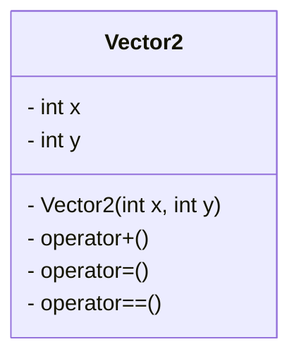
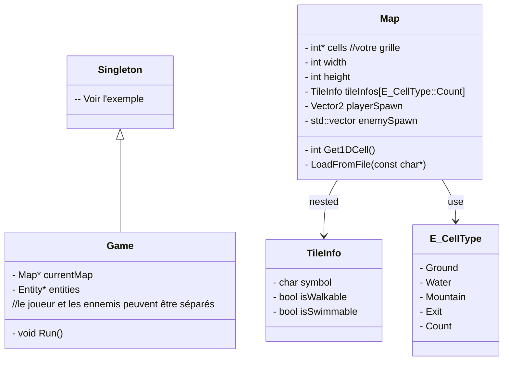
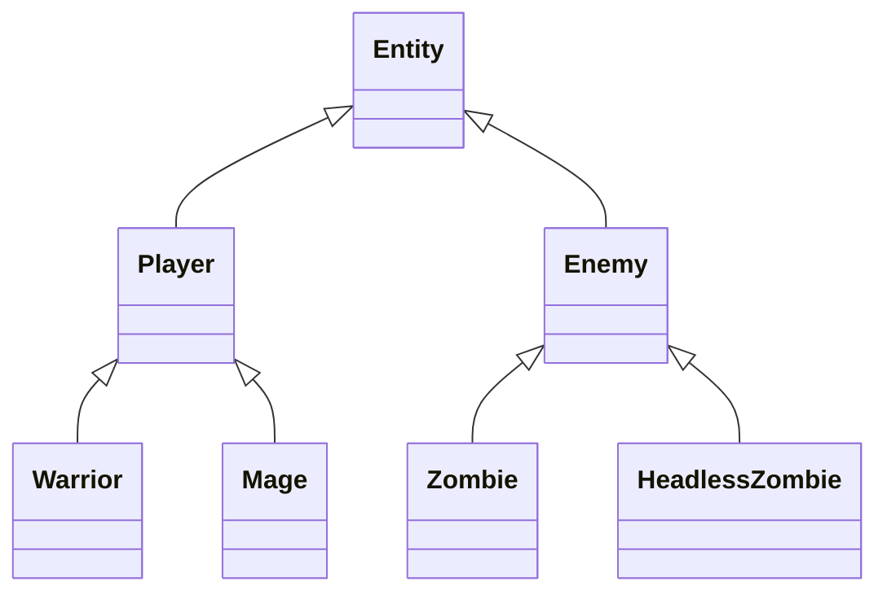
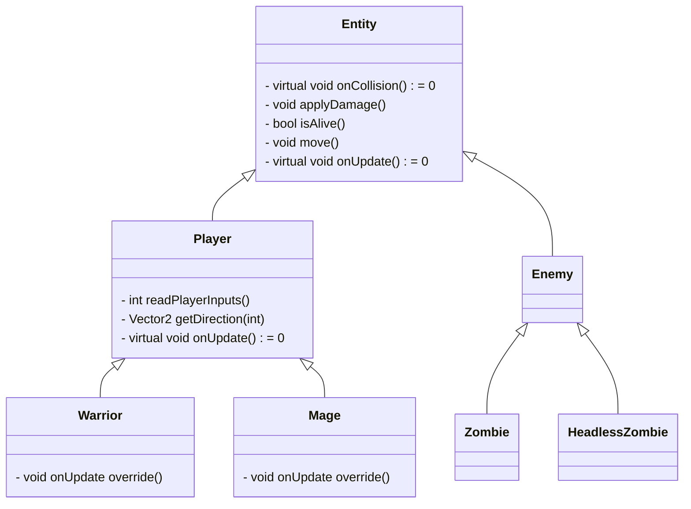
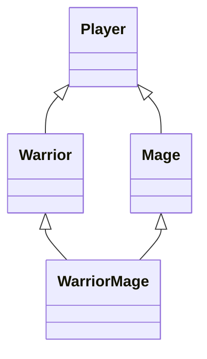
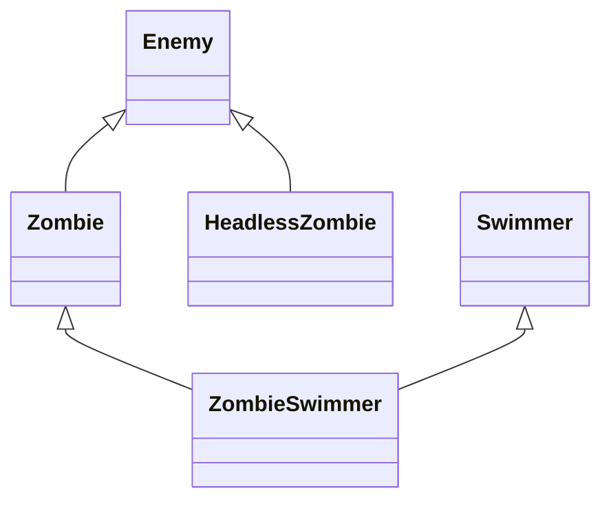

# Guide pour établir votre architecture

*Oui, ce sera en français pour éviter les incompréhensions pour une fois.*

## Introduction

*Ce guide va utiliser le [projet de référence](https://github.com/HeartBeat-Games/Imperative-Programming-CPP) comme code d'origine. Je vous encourage à vous en inspirer un maximun, mais vous pouvez vous limiter à votre ancien code.*
La première question que vous pouvez vous poser : **que doit faire mon programme et à quoi va ressembler la structure globale ?**. Cette question j'y ai répondu pour vous avec le diagramme de base et les indications supplémentaires. Vous savez donc que vous allez vouloir faire un **Jeu avec une game loop tour par tour : Joueur => Ennemi**, sur une **Map représentée par une grille avec différent type (int) de cellules**, le tout parcourus par un **Player** et des **Enemy** qui ont l'air d'avoir une structure logique commune importante (par exemple ils se déplacent tous sur la carte). On pourrait donc leur faire une classe parent **Entity** et s'arrêter là pour une première étape. Mais pour ne pas faire un guide encore plus long, on va ajouter tout de suite les "spécialisations" de **Player** (**Warrior** et **Mage**) et de **Enemy** (**Zombie** et **HeadlessZombie**). Pour le **WarriorMage** et le **ZombieSwimmer** ont les laisse de côté pour la première étape et on reviendra en détails sur chacun d'entre eux.


---
Si jamais vous n'accrochez pas avec l'exercice de réfléchir un peu à la strucutre du code en amont : **ce n'est pas grave**. Vous pouvez toujours implémenter les classes petit à petit, en commencant par les classes "finales" (évitez **WarriorMage** et **ZombieSwimmer**). Une fois que vous aurez, par exemple, **Warrior** et que vous ferez **Mage** vous remarquerez le code commun et vous "n'aurez plus qu'à" le réunir dans la classe **Player** et en faire hériter **Warrior** et **Mage**.

## Utilities

Avant de commencer je réintroduis mon ami le **Vector2**, qui est juste l'aggloméra de deux nombres **x** et **y**.


En plus de répuire le nombre de paramètres de vos functions, il est également possible en C++ de charger le comportement des opérateurs +,-,=, ==... Ce qui vous permetra d'écrire des choses du genre :

```cpp
Vector2 newPos = player.pos + dir;
//ou player.pos et dir sont également des Vector2
```

Je vous encourage donc très fortement à faire au moins cette classe/struct **Vector2**. Et de regarder pour les [opérateurs](https://www.geeksforgeeks.org/cpp/operator-overloading-cpp/).

## Game et Map

Pour cette première partie je vais donner pas mal de détail (non exhaustif quand même) sur la structure comme vous avez le code. Ici on utilise un tableau à une seule dimension pour représenter la grille, mais un tableau 2 dimensions ne change rien à la logique. La différence principale avec le code de beaucoup d'entre vous, c'est le tableau qui contient les metadata/informations pour chaque type de cellule. Et justement, le int dans int* cells,  correspond à l'index de ce tableau. Donc si j'ai 0 (Ground) dans `cells[index]` alors je peux récuprer les informations avec `tileInfo[0]`.


[Singleton example](https://refactoring.guru/fr/design-patterns/singleton/cpp/example)


Au final votre main ne devrait contenir que ca :
```cpp
int main()
{
    Game* game = Game::GetInstance();
    game->Run();
    // on oublie pas de delete dans le destructeur
    return 0;
}
```
## Entity

### L'arborescence simple

### Où placer qu'elle fonction ?

Pour débuter, je pense qu'il est plus simple de réfléchir de "bas en haut". Réfléchir aux fonctions des classes finales et "faire remonter" quand c'est en commun.
Ce qui veux dire que si Warrior doit pouvoir se déplacer et donc, peut-être, appeller une fonction du style `void move(Vector2 dir)` et que c'est aussi le cas pour Mage... Alors Player peut avoir `void virtual move(Vector2 dir)`. Si l'intérieur de la fonction est la même entre Warrior et Mage, alors on peut juste écrire la logique dans Player et ne pas override dans les enfants. Si le contenu est différent alors vous pouvez forcer les enfants à implémenter leur propre logique avec `virtual void move(Vector2 dir) = 0`. Vous pouvez également écrire une première logique dans Player avec `virtual void move(Vector2 dir)`, qui sera `override` ou non dans chaque enfant.

### A quel point découper les fonctions ?

En dehors de la taille imposée, vous pouvez réfléchir avec les "spécialisations" de vos classes enfants. Par exemple, **Zombie** et **HeadlessZombie** on une logique de déplacement différente: le premier se déplace vers le joueur et le deuxième bouge aléatoirement. Si on repense à votre ancien code cela veut dire que l'un applique une certaine logique pour trouver la **direction** dans laquelle se déplacer et l'autre fais un rand pour choisir cette **direction**. Et comme vous **détestez** duppliquer du code, il faudrais que **le calcul de cette direction** soit la seule chose à écrire dans les classes filles. Vous avez donc besoin au minimun d'une fonction `Vector2 getDirection()` qui sera virtuelle pure dans Enemy et override dans les 2 classes filles.

### Un exemple avec le déplacement

Code simplifié en provenance du projet exemple :
```cpp

    // Logique principale du joueur
    E_PlayerAction playerAction;
    Vector2 dir;

    playerAction = readPlayerInputs(); // récupère l'action trigger par le clavier
    dir = getDirection(playerAction); // calcul la direction de cette action
    characterMove(player, dir, currentMap, characters); //déplace le personnage


    // Logique principale des ennemies
    Vector2 dir;

    dir = getRandomDirection(); // génère une direction random
    characterMove(characters.data[i], dir, currentMap, characters); //déplace le personnage
```

On peut donc voir que seule la fonction `characterMove` est identique entre les deux. On peut également se dire que les deux logiques ayant besoin des mêmes paramètres... une fonction `onUpdate` serait une bonne idée. Ce serait donc des candidats pour **Entity**.


La même réflexion s'applique sur uniquement **Player** ou **Enemy**. **Warrior** et **Mage** vont tous les deux `readPlayerInputs` et `getDirection`, ce sont donc des candidats pour la classe **Player**.


Cependant, **le Mage peut effectuer une action supplémentaire**. On pourrait donc vouloir spécialiser `readPlayerInputs`, avec un override chez le Mage pour écrire sa propre logique. Et si on veut éviter le code duppliqué alors on fait une première fonction qui s'occupe uniquement de **ZQSD** et l'autre de la touche **action**. Mais ce n'est pas la seule manière de penser. On peut également partir du principe que `readPlayerInputs` est une fonction qui "renvoie la touche appuyée" et qu'elle n'a pas à bloquer directement la "lecture" de la touche en fonction de **Warrior** ou **Mage**, cette dernière renverais donc également la touche **action** dans la classe du **Warrior** et ce serais dans `onUpdate` que on ferrais le traitement de l'action d'une manière différente entre **Warrior** et **Mage**.


C'est le override de `onUpdate` que je vais mettre dans le schéma, mais vous pouvez faire comme bon vous semble.

J'aimerais finir l'exemple avec la collision. Pour ca il faut d'abord aller (dans ce code) au niveau de la fonction de movement.
```cpp
bool characterMove(
    Character& character, Vector2& dir,
    Map& map, Characters& characters)
{
    Vector2 newPos = character.pos;
    newPos.x += dir.x; // override + operator for less code
    newPos.y += dir.y;

    // Borders check
    if (newPos.x < 0 || newPos.x >= map.width ||
        newPos.y < 0 || newPos.y >= map.height)
        return false;

    int mapIndex = get1DCell(newPos, map.width);
    int cellType = map.cells[mapIndex];

    if (!g_cellInfos[cellType].isWalkable)
        return false;

    if (characterMoveCollision(character, newPos, characters))
        return false;

    character.pos = newPos;

    return true;
}
```
Ca me permet de vous remettre sous les yeux la séparation de la logique de mouvement :
- calcul de la nouvelle position théorique
- check des bordures de la carte
- check de si on peut aller sur la cellule (que la pluspart d'entre vous on fais avec une fonction comme vous n'aviez pas le tableau de cellInfos)
- check si il y a pas quelqu'un déjà sur la cellule
- appliquer la position si tout est passé


De mon côté, characterMoveCollision (nom pas ouf) est complètement générique et n'a pas besoin d'être override.
```cpp
bool characterMoveCollision(
    Character& character, Vector2& newPos,
    Characters& others)
{
    for (int i = 0; i < others.size; ++i)
    {
        Character& other = others.data[i];

        // Collision with currently moving character ?
        if (other.isAlive &&
            other.pos.x == newPos.x &&
            other.pos.y == newPos.y)
        {
            if (other.type == character.type)
                return true; // Can't collide with the same character type
            else
                characterBattle(character, other);
        }
    }

    return false;
}
```

Cette fonction applique une seule règle, si il y a un personnage du même type (Enemy ou Player) sur la ceullue, alors on ne peut pas y aller. Sinon il y a "contact".
Et justement, dans le projet actuel, ce qui se passe à la collision dépend de votre classe finale. **Warrrior** fait **BOUM BOUM** et le **Mage** fait **AIE AIE** tandis que les **Enemy** meurt sur le coup. Certains font des dégâts et d'autres non ! Il y a plein de logiques différentes !

C'est donc le moment d'introduire `onCollsion` ! Le suffixe **on** est un standard pour les fonctions qui se lancent **suite à un évènement du jeu**. Et notre `onCollision` va traduire la collision entre 2 entity : `void onCollision(Entity* other)`. Pourquoi il n'y a qu'un seule Entity en paramètre ? Parceque ce sera une fonction membre de Entity ! Ce qui reviens à dire que vous aller avoir cette logique : `Warrior->onCollision(Zombie)`. Et pour finir il est assez claire que on va vouloir pouvoir appliquer des dégâts à l'**Entity**, il faudrait donc au moins une fonction `void applyDamage(int)` directement disponible dans **Entity**.


On s'arrête la pour l'exemple et voici le schéma récapitulatif et toujours non exhaustif:


## L'héritage avancé

### WarriorMage (Diamond inheritance)



### ZombieSwimmer (Composition by inheritance)

