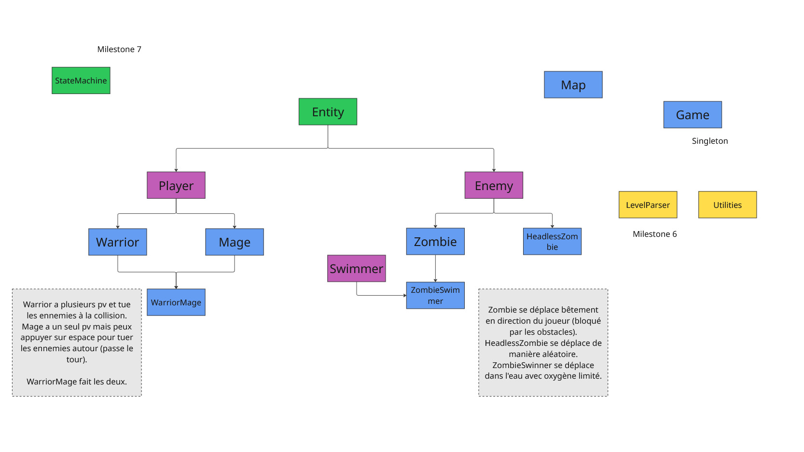
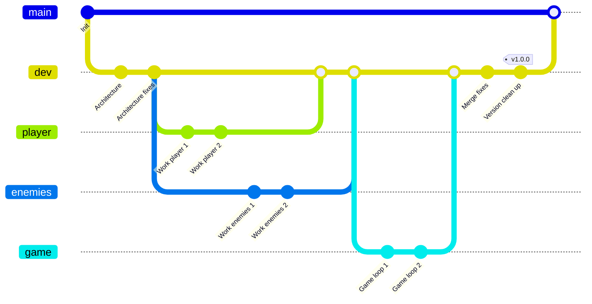

# OOP-Courses

## Théorie
[Reference pour la théorie](https://www.geeksforgeeks.org/cpp/c-plus-plus/)

## Projet

L'objectif est de refaire le [précédent projet](https://github.com/HeartBeat-Games/Imperative-Programming-CPP) en orienté objet, avec quelques fonctionnalités supplémentaires. L'architecture du projet est imposée et disponible ci-dessous avec la description des nouvelles fonctionanlités.

[Guide pour démarrer](Project/ArchitectureGuide.md)

## Git flow

La gestion de votre répertoire git est imposée de la manière suivante :

## Coding style

Le travail de groupe permet d'introduire les conventions de code : [Convention par défaut](Project/CodingStyleCPP.md). Le nombre de **caractères par ligne (90)** et le nombre de **lignes par fonction (25)** n'est pas modifiable. Pour le reste, il faut juste que l'intégralité du code du groupe respecte la convention qui sera disponible dans le répertoire du projet.

## Tests unitaires

**Ceci n'est pas une obligation du projet**. Mais si vous voulez tester rapidement un morceau spécifique de code, et être sur que rien n'est cassé quand vous ajoutez des choses, je vous recommande de vous pencher sur un outil de tests unitaires comme [GoogleTests](https://google.github.io/googletest/).

## Project grade breakdown

| Description | Potential Points |
| --------------- | --------------- |
| Entity-Player-Enemy | 30 |
| Map-Game | 20 |
| Warrior-Mage-Zombie-HeadlessZombie | 30 |
| WarriorMage | 10 |
| ZombieSwimmer | 10 |
| **Total** | **100** |
| --------------- | --------------- |
| *Bonus* | *10 max* |

*To get **all the points of one categorie**, you need to have classes which does what they must, with no useless code or virtual stuff. If the code run and do what's asked for, you'll get at least half the points.*

*The **file parser** doesn't gives points, it's just for you if you add it.*

#### Malus

| Description | Potential Points |
| --------------- | --------------- |
| Line and character limit broken | -10 |
| "Sphagetti" code | -10 (1 time max) |
| Code convetion broken "heavily" | -5 (1 time max) |
| Useless class | -10 (1 time max) |
| Git flow not respected "heavily" | -5 (1 time max) |

**Useless class** *will be determined if you can justify it in the oral or not. But you can simply limit yourself to the original diagram.*

#### Bonus possible

| Description | Potential Points |
| --------------- | --------------- |
| NCurse integration (well done) | 5 |
| State machine | 5 |
| Design pattern outside Singleton | 2-3 |

**NCurse integration** *points depend of the features used*.